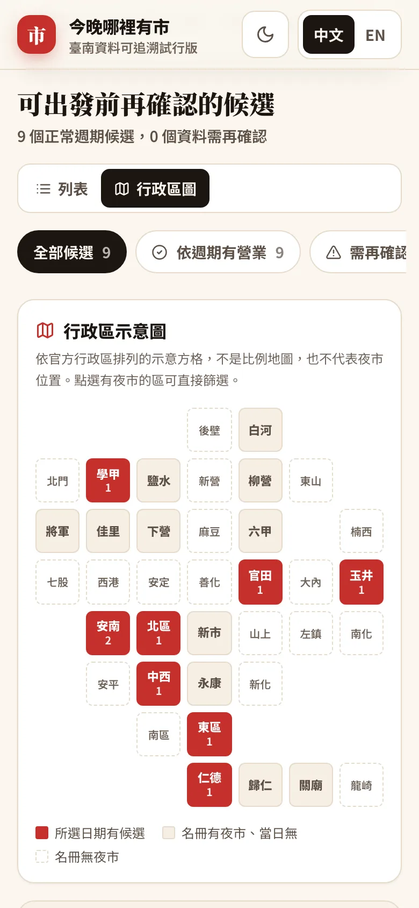

# 今晚哪裡有市

一個 trust-first 的臺南夜市決策工具：依臺南市政府許可名冊，查所選日期**正常週期**有營業的候選，並逐欄位顯示來源、核對時間、過期與來源衝突。

**線上 demo：<https://livejiaquan.github.io/taiwan-night-market-finder/>**

| 桌面（淺色） | 手機（深色） | 手機行政區圖 |
|---|---|---|
|  |  |  |

| 夜市詳情與逐欄位來源 |
|---|
|  |

首頁第一眼是「所選日期有幾個夜市依週期排定營業」、七日日期列（每天附候選數）、狀態篩選，以及臺南 37 區示意方格圖；每張卡片都顯示來源機關與比對日期。介面設計依據見 [design research](docs/design-research.md)。

它不宣稱即時開門，也不以沒有來源的精確鐘點、美食排行或路線填補官方資料缺口。目前是 `pre-alpha / 臺南資料可追溯試行版`，不是全臺完整名冊。

## Public product 與保留原型

- `/`：所選日期的臺南正常週期候選；預設為 `Asia/Taipei` 今天，可選填官方行政區縮小候選。
- `/market/:id`：夜市詳情、逐欄位 evidence、Maps 搜尋導航與可分享日期連結。
- `/lab`：原本的雙視覺比較 prototype。
- `/style/neon`、`/style/travel`：原本的視覺方向；其 19 筆手工策展資料不進 public product。

產品方向、release gate 與資料邊界見：

- [產品使命](docs/PRODUCT_MISSION.md)
- [資料信任契約](docs/DATA_TRUST_CONTRACT.md)
- [outcome-gated roadmap](docs/ROADMAP.md)
- [第一輪 UX contract](docs/ITERATION_1_UX_BRIEF.md)
- [行政區可逆實驗](docs/ITERATION_2_DISTRICT_HYPOTHESIS.md)
- [介面設計研究與取捨](docs/design-research.md)

## Current source of truth

第一階段只使用[臺南市已取得設置許可夜市名冊](https://data.gov.tw/dataset/53634)作為主要來源。`2026-08-09` 的 live snapshot 有 32 筆，提供：

- record `Seq`；
- 夜市名稱；
- 許可路段或區域；
- 正常營業日；
- 地址行政區域代碼。

行政區名稱則由臺南市政府研究發展考核委員會的[臺南市各區代碼](https://data.tainan.gov.tw/DataSet/Detail/70d961d2-9f38-4112-847d-907b436820ab)對照。`2026-08-11` snapshot 有 37 筆；只有夜市名冊的 `adminCode` 與此官方 code table exact join 時，才顯示或接受行政區 filter。這個 filter 不是附近、距離或推薦排序，也不會改變正常營業日、過期或衝突判斷。

它**沒有**提供即時開門狀態、例外停業、可信精確鐘點或官方經緯度。Maps CTA 是由官方名稱與許可區域衍生的搜尋字串，不是官方座標。

已知衝突會保留兩個值，不採 latest-wins。例如花園夜市的許可名冊為四／六／日，[臺南旅遊網](https://www.twtainan.net/zh-tw/attractions/detail/5572/)為四／五／六／日；因此週五顯示「需再確認」，其餘兩來源一致的日期仍可獨立判斷。

政府資料依[政府資料開放授權條款第 1 版](https://data.gov.tw/license)使用並顯示提供機關與原始連結。

## Reproducible data path

```text
official endpoint
  -> immutable raw snapshot + SHA-256 + retrievedAt
  -> strict schema / row / key / schedule validation
  -> manual official-source conflict file
  -> generated production artifact with field-level evidence
  -> runtime validation and day-specific claim policy

official district-code endpoint
  -> immutable raw snapshot + SHA-256 + retrievedAt
  -> strict 37-row code/name/sequence validation
  -> generated district reference + exact market adminCode join
  -> optional administrative-area filter / label
```

離線驗證目前已提交的 snapshot、curation 與 generated artifact：

```bash
npm run data:check
```

抓取 live endpoint、fail-closed 驗證後建立新 immutable snapshot：

```bash
npm run data:sync
```

更新官方行政區 code reference（獨立於夜市 normal-schedule source）：

```bash
npm run data:sync:districts
```

遇到零筆、欄位改名、非 32 筆市場／37 筆行政區、重複 ID／code／名稱、未知營業日格式、checksum 不符、無法 exact join 或 curation 與主來源不再一致時，pipeline 會失敗且不發布 candidate。新 snapshot 不會覆寫舊 snapshot。行政區 reference 超過 365 天未重新核對時，runtime 會 fail closed；它不使用 normal schedule 的 90-day freshness 門檻。

## Local development

建議 Node 22（見 `.nvmrc`）；production 支援範圍固定為 Node `>=20.19 <25`。

```bash
nvm use
npm ci
npm run dev
```

Vite 預設綁定 `127.0.0.1`。

## Quality checks

```bash
npm run data:check
npm test
npm run typecheck
npm run lint
npm run build
npm audit --audit-level=high
npm run test:e2e:chromium
npm run test:e2e
```

完整本機 gate：

```bash
npm run verify
```

`npm run build` 會先重建並核對 committed data lineage，再輸出靜態 `dist/`。

## Deployment

這是無 runtime credential 的靜態 Vite app。`public/_redirects` 提供 Netlify／Cloudflare Pages 類型 host 的 SPA deep-link fallback；其他 host 需將所有未知路徑 rewrite 到 `index.html`。

先 build，再用實際 HTTPS 網域產生 absolute canonical、robots sitemap、每筆市場 URL 的 crawler-readable metadata shell 與明確 SPA rewrite；命令拒絕自行發明 production domain：

```bash
npm run build
npm run deploy:metadata -- --site-url https://your-real-domain.example
```

完整 DNS、TLS、cache 與回滾檢查見 [deployment runbook](docs/DEPLOYMENT.md)。沒有網域／host credential 時仍可驗證 build，但不可聲稱已正式上線。

## Repository boundary

原有的 generated hero、SVG map、19 筆 prototype data 與視覺 screenshots 都被保留；它們僅支援 `/lab`，不得當成 production truth。唯一例外是 hero 圖：已由 2.4 MB PNG 壓成約 150 KB WebP，首頁只拿來當裝飾背景並標註「示意插圖，非特定夜市」。此 repository 不含 API key、Google Places 抓取、帳號或 AI branding。
